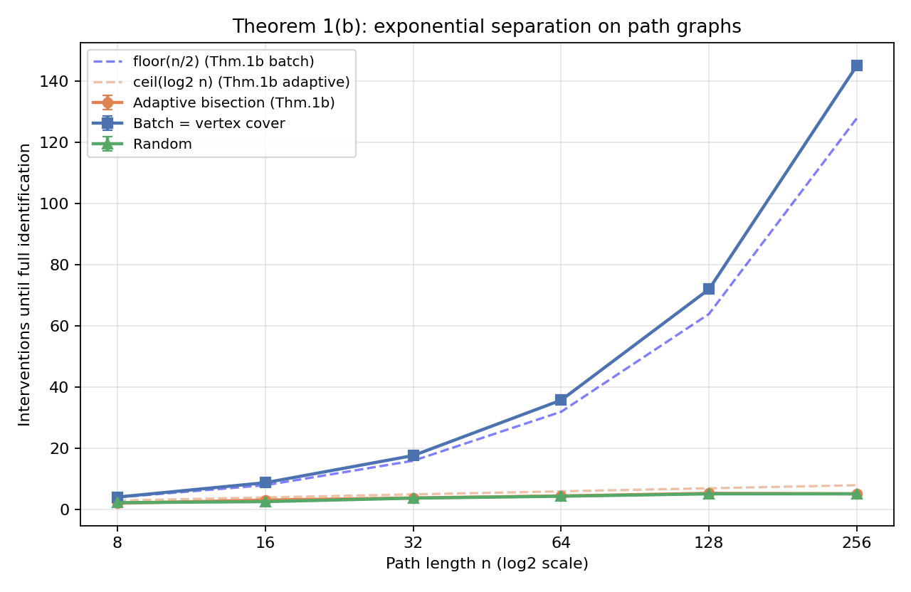

# Intervention

**Minimal Active Interventions for Causal Representation Learning** — a three-paper research program:

1. **Identifiability** as a measurable, convex-geometric quantity;
2. **Where to intervene** — adaptive intervention placement importing structural controllability from control theory (flagship, in progress);
3. **Minimal interventions** — convex relaxations, budgets, and sample complexity.

## Start here

- 📄 [`WHITEPAPER.md`](WHITEPAPER.md) — the complete program whitepaper
- 📐 [`proofs/THEOREM1.md`](proofs/THEOREM1.md) — self-contained proofs (Proposition 0: batch = vertex cover; Theorem 1: adaptive–batch separation with $\lfloor n/2\rfloor$ vs $\Theta(\log n)$ on paths)
- 🧪 [`experiments/`](experiments/) — running code and data validating Theorem 1(b) (28× separation at n=256)
- 📚 [`docs/`](docs/) — literature sweep (~80 works), research plan, formalization notes (中文)

## Key experimental result

