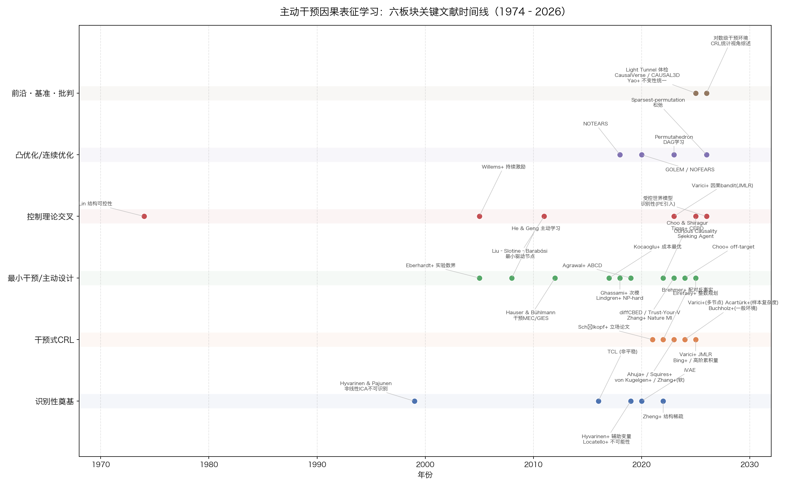
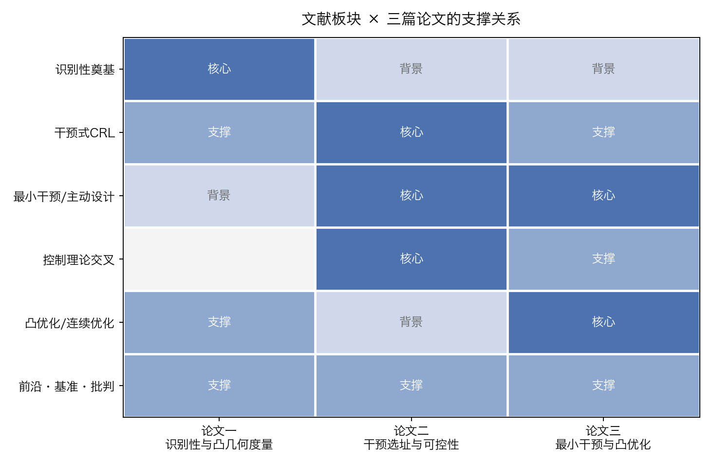

# Minimal Active Interventions for Causal Representation Learning

**A Research Program Whitepaper**

*Dongqi Zuo · October 2026 · Working draft v0.2*

---

## Abstract

Causal representation learning (CRL) aims to recover latent causal variables and their structure from low-level observations. Its core obstacle is **identifiability**: from observational i.i.d. data alone, latent representations are determined only up to arbitrary invertible transformations. Among all routes to identifiability, **interventional data is the weakest-assumption, strongest-guarantee source** — yet the theory so far assumes interventions are *given*. This whitepaper lays out a three-paper research program that turns intervention from a passive assumption into an **actively optimized resource**:

1. **Paper 1 — Identifiability as a measurable quantity.** Why identifiability fails, and a convex-geometric "entanglement measure" that turns partial identifiability from a qualitative equivalence class into a continuous, differentiable, optimizable object.
2. **Paper 2 — Where to intervene.** An adaptive intervention-placement theory that imports **structural controllability** (minimum driver nodes, Kalman decomposition, persistent excitation) from control theory into CRL. *Flagship, started first.*
3. **Paper 3 — Minimal interventions.** The cost closure: convex relaxations (ℓ₁/SDP), optimal experimental design, submodularity and sample-complexity accounting for intervention budgets.

The program is positioned against Kun Zhang's "minimal change / sufficient change" program: they minimize **assumptions** about passively observed distribution shifts; we minimize **actions** — actively manufacturing the variation that identifiability requires, at minimal cost.

---

## 1. The Identifiability Crisis (Background for Paper 1)

### 1.1 Why identifiability is a problem

Nonlinear ICA without additional structure is ill-posed: Hyvärinen & Pajunen (1999) showed that with a general nonlinear mixing map, independence and non-Gaussianity of the sources do **not** suffice to recover them — infinitely many invertible reparameterizations yield the same observed distribution. Locatello et al. (ICML 2019) extended this to all of unsupervised disentanglement: without inductive biases or supervision, identifiable representations are impossible, empirically confirming that no existing unsupervised method reliably recovers ground-truth factors.

The consequence for CRL: "learning the causal variables of the world" is not an engineering challenge but a **mathematical ill-posedness**. The entire field is therefore organized around one question — *what extra structure collapses the solution space to an acceptable equivalence class?*

### 1.2 The four existing routes

| Route | Key works | Mechanism | Price |
|---|---|---|---|
| Auxiliary variables / weak supervision | Hyvärinen, Sasaki & Turner 2019; Khemakhem et al. 2020 (iVAE) | Conditional independence of latents given observed $u$ | Sufficient-variability: $u$ needs ≥ $2n+1$ distinct values |
| Temporal structure | TCL/PCL (2016/17); Klindt et al. 2021 | Nonstationarity, temporal dependence | Requires segmented time series |
| Mixing-function constraints | Zheng, Ng & Zhang, NeurIPS 2022 | Structural sparsity of the mixing Jacobian | Sparsity must hold a priori |
| Multi-view | Gresele et al. 2020; Locatello et al. 2020 | Shared/exclusive content across views | Multiple simultaneous views |

All four deliver **equivalence-class statements** ("identifiable up to permutation and componentwise transformation"). None provides a *continuous* answer to the practitioner's question: **how far from identifiable am I right now?**

### 1.3 Paper 1's contribution: a convex-geometric entanglement measure

Ahuja et al. (ICML 2023) showed interventions help through a **geometric signature**: a perfect intervention decouples the *support* of the intervened latent variable from the support of its ancestors. Supports, support functions, convex hulls, Minkowski sums are all native objects of convex analysis. Paper 1 proposes:

- Define an **entanglement measure** $\mathcal{E}(\hat g, \mathcal{I})$ — the deviation between the support-function family of the learned representation and that of the truth — making partial identifiability continuous, differentiable, and optimizable.
- Identifiability theorems become convergence statements: $\mathcal{E} \to 0$ ⟺ identification achieved.
- Motivated by the Light Tunnel sanity check (ICML 2025), where all tested CRL methods **failed** on a controlled real optical system — with failures ambiguous between *model misspecification* and *optimization failure*. A diagnostic measure that separates the two is exactly what the field currently lacks.

---

## 2. Why Intervene, and Where (Paper 2, flagship)

### 2.1 Why interventions

Interventional CRL requires the weakest distributional assumptions of any known route: with perfect interventions, latent causal factors are identifiable up to permutation and scaling **without any assumption on the latent distribution or dependency structure** (Ahuja et al. 2023). The "one intervention per latent node" benchmark is both sufficient and worst-case necessary (Squires et al., ICML 2023, linear setting; extended to non-injective mixing via higher-order cumulants, 2025). The theory has since been relaxed along a clear path — known targets → unknown targets (von Kügelgen et al. 2023) → uncoupled environments (Varıcı et al. 2023/2024) → unknown multi-node interventions (Varıcı et al., NeurIPS 2024) → logarithmically many interventional environments (2026) — and a first sample-complexity account exists (Acartürk et al., NeurIPS 2024).

Interventions are also realistic data: CRISPR perturbations, optogenetic stimulation, robot actions, and recommender-system pushes are all interventions.

### 2.2 The missing layer: *placement*

Every result above assumes the intervention set is **given**. CRL has no algorithmic answer to *where to intervene*. Classical causal discovery has that answer only for the variables-are-known case: minimum intervention counts (Eberhardt et al. 2005), interventional Markov equivalence (Hauser & Bühlmann 2012), cost-optimal separating systems (Kocaoglu et al. 2017), NP-hardness of minimum-cost design with greedy $(2+\varepsilon)$-approximation (Lindgren et al. 2018), submodular budgeted design (Ghassami et al. 2018), adaptivity complexity (Choo & Shiragur 2022–2024), and Bayesian experimental design (Tigas et al. 2022; diffCBED, ICML 2023). None of it transfers directly to latent-variable CRL.

### 2.3 What control theory contributes

| Control theory | Causal learning analogue |
|---|---|
| Minimum driver nodes for structural controllability (Lin 1974; Liu–Slotine–Barabási 2011) | Minimum intervention set for identifiability |
| Bipartite matching / SCC decomposition | Separating systems / colorings |
| Kalman decomposition (controllable/uncontrollable × observable/unobservable) | **Identifiable / non-identifiable subspace decomposition** — missing in CRL |
| Persistent excitation (Willems et al. 2005) | Sufficient-variability / excitation conditions for identification |
| Dual control (Feldbaum 1960s) | Interventions simultaneously learn and act (causal RL) |

The asymmetry is the opportunity: controllability assumes the structure is **known** and asks where to inject inputs; causal learning asks where to intervene when the structure is **the unknown object**. Paper 2 embeds the matching/SCC machinery as a *subroutine* inside an adaptive learning loop, and uses Kalman-style decomposition to state **negative theorems**: which latent directions no sequence of interventions can ever identify (e.g., unreachable states, null-space directions of the mixing map).

Recent signals that this bridge is timely: *On the Identifiability of Controlled World Models* (2026) already imports a persistent-excitation-style margin into world-model identifiability; the Curious Causality-Seeking Agent (NeurIPS 2025) explicitly lists unreachable states and budget-aware exploration as open problems. Our differentiation: they give *passive* identifiability conditions or heuristic exploration; we give *active* placement algorithms with optimality and boundary theorems.

### 2.4 Theorem 1 (stated; full proofs in `proofs/THEOREM1.md`)

Setup: observational essential graph $E(G^*)$ given; single-node perfect interventions; identification = all edges oriented (the $\mathcal{I}$-essential graph is a singleton).

- **Proposition 0 (batch = vertex cover).** A batch intervention set $S$ identifies $G^*$ for every member of the MEC iff $S$ is a vertex cover of the undirected edges $U_0$: $\nu^{\mathrm{batch}}(G^*) = \tau(U_0)$.
- **Theorem 1(a) (domination).** $\nu^{\mathrm{ada}}(G^*) \le \nu^{\mathrm{batch}}(G^*)$ for every DAG.
- **Theorem 1(b) (exponential separation).** On directed paths $P_n$: $\nu^{\mathrm{batch}}(P_n) = \lfloor n/2 \rfloor$ while $\nu^{\mathrm{ada}}(P_n) = \Theta(\log n)$.
- **Theorem 1′ (CRL layer, in progress).** With latent linear SCM and injective linear mixing $H$, the batch baseline becomes a **joint covering problem**: vertex cover (edge orientation) **+ $H$-anchoring constraints** (mixing-matrix identification). This joint object does not exist in the literature.

### 2.5 Experimental status

Implemented and running (`experiments/`, results on an A800 server):

- **v0 (ER graphs, d up to 30, 60 graphs per setting):** ordering confirmed — oracle ≤ adaptive < batch < random; all far below the worst case of $d$ interventions. The adaptive–batch gap is modest (~7% at d=30) because Meek propagation does most of the work in sparse ER graphs — itself an instructive observation: *placement matters in proportion to the uncertainty propagation cannot carry away.* [assets/fig_v0_curve.png](assets/fig_v0_curve.png)
- **Path family (Theorem 1(b) validation, n up to 256):** batch grows linearly (145.2 at n=256, vs ⌊n/2⌋=128; greedy cover overhead), adaptive bisection grows logarithmically (5.2 at n=256, below the ⌈log₂ n⌉=8 worst-case bound — boundary cascades beat the adversary's freedom). Separation ≈ 28× and widening. [assets/fig_path_separation.png](assets/fig_path_separation.png)

| n | Batch (vertex cover) | Adaptive bisection | ⌊n/2⌋ | ⌈log₂ n⌉ | Separation |
|---|---|---|---|---|---|
| 8 | 4.12 | 2.10 | 4 | 3 | 2.0× |
| 32 | 17.70 | 3.85 | 16 | 5 | 4.6× |
| 128 | 72.08 | 5.35 | 64 | 7 | 13.5× |
| 256 | 145.20 | 5.20 | 128 | 8 | 27.9× |

---

## 3. How to Intervene Minimally (Paper 3)

Three senses of "minimal," each with its tool:

| Level | Question | Tool |
|---|---|---|
| Fewest interventions | How many experiments suffice? | Lower-bound theory + convex-relaxed placement |
| Smallest single intervention | Fewest variables / weakest strength per experiment | Continuous relaxation = optimal experimental design |
| Lowest total cost / samples | Heterogeneous costs, budgets | Submodularity + Lovász extension; sample complexity |

Key entry points:

1. **Convex relaxation of the NP-hard design problem.** Minimum-cost intervention design is NP-hard (Lindgren et al. 2018); existing approximations are greedy/combinatorial. ℓ₁ relaxation of the cardinality constraint and SDP relaxations (mature for mixed-integer D-optimal design) are **unused** in this literature.
2. **Continuous intervention allocation = convex optimal experimental design.** Relax "which variables" to a budget vector $w$ on the simplex; maximize $\log\det \sum_i w_i M_i$ (D-optimality). KKT multipliers give *shadow prices* of interventions — a clean marginal-information-value semantics absent from current entropy-greedy heuristics.
3. **Submodularity and the Lovász extension for budgets.** Ghassami et al. (2018) already proved the budgeted objective is submodular (greedy gives $1-1/e$); the Lovász extension turns batch allocation under budgets into convex duality.
4. **Sample complexity.** Extending Acartürk et al. (NeurIPS 2024) — $O((\log \tfrac1\delta)^4)$ samples for graph-up-to-ancestors — to the adaptively-selected, convex-relaxed setting; plus DRO-style certificates for extrapolation to unseen interventions (linking to Saengkyongam et al., ICLR 2024).

---

## 4. Positioning: Two Senses of "Minimal"

Kun Zhang's program (CMU/MBZUAI) sells **minimal change**: the modularity of causal systems implies that when distributions shift, a *minimal* set of mechanisms changes, *independently*. Its technical incarnations — sufficient-change conditions (≥ $2n+1$ environments) and sparse mechanism shifts — underpin a recent line culminating in *CRL from Multiple Distributions* (ICML 2024), which deliberately assumes **no** hard interventions behind distribution changes.

| | Zhang's program | This program |
|---|---|---|
| What "minimal" modifies | **Assumptions / changes** | **Actions / experiments** |
| Data | Passive shifts, temporal nonstationarity | Actively chosen interventions |
| Core condition | Sufficient change (≥ $2n+1$ environments) | 1–2 interventions per latent node; separating systems |
| Stance | Wait for nature's footprints | Manufacture footprints, minimally |

The deep connection: **sufficient change is the passive analogue of persistent excitation**. When passive data fails the sufficient-change condition — and empirically it does (CausalVerse: all methods' MCC < 0.6 with only 4 views available, far below $2n+1$) — active intervention is how you *manufacture* the missing excitation at minimal cost. Zhang himself (2026 keynote Q&A) acknowledged that intervention placement on learned latents is the open boundary. The two programs compose: their passive results bound what is recoverable without actions (Paper 1's lower reference); we measure how much each action adds and where to add it cheapest.

---

## 5. Literature Map

Six blocks, ~80 works, 1974–2026 (full sweep: `docs/literature_sweep_zh.md`).





## 6. Roadmap (24–30 months)

1. **Months 0–6 — Paper 2 core**: finalize Theorem 1(c) (verification-number upper bound), Theorem 1′ (joint covering), Theorem 2 (Kalman-type identifiability boundary); experiments on Causal3DIdent / CausalVerse / scRNA-seq.
2. **Months 4–14 — Paper 1 in parallel**: entanglement measure in the linear setting first; diagnostic validation on the Light Tunnel benchmark (separating misspecification from optimization failure).
3. **Months 12–24 — Paper 3**: convex relaxations, budgeted allocation, sample-complexity closing theorem $\mathcal{E} \le f(B, d, n)$.

## Repository layout

```
├── WHITEPAPER.md               ← this document
├── proofs/THEOREM1.md          ← complete proofs (self-contained)
├── experiments/                ← v0 + path-family experiments (code & data)
├── assets/                     ← figures
└── docs/                       ← literature sweep, research plan, notes (中文)
```

## Key references (entry points)

- Ahuja, Mahajan, Wang & Bengio. *Interventional Causal Representation Learning*. ICML 2023.
- Squires, Seigal, Bhate & Uhler. *Linear Causal Disentanglement via Interventions*. ICML 2023.
- von Kügelgen et al. *Nonparametric Identifiability of Causal Representations from Unknown Interventions*. NeurIPS 2023.
- Varıcı, Acartürk, Shanmugam, Kumar & Tajer. *Score-based CRL: Linear and General Transformations*. JMLR 2025.
- Acartürk, Varıcı, Shanmugam & Tajer. *Sample Complexity of Interventional CRL*. NeurIPS 2024.
- Hauser & Bühlmann. *Characterization and Greedy Learning of Interventional Markov Equivalence Classes*. JMLR 2012.
- Ghassami et al. *Budgeted Experiment Design for Causal Structure Learning*. 2018.
- Choo & Shiragur. *Verification and search algorithms for causal DAGs*. NeurIPS 2022; *Adaptivity complexity*. UAI 2023.
- Lindgren, Kocaoglu, Dimakis & Vishwanath. *Experimental design for cost-aware learning of causal graphs*. NeurIPS 2018.
- Tigas et al. *Interventions, Where and How?* NeurIPS 2022; *diffCBED*. ICML 2023.
- Zhang, Cammarata, Squires, Sapsis & Uhler. *Active learning for optimal intervention design in causal models*. Nature Machine Intelligence 2023.
- Liu, Slotine & Barabási. *Controllability of complex networks*. Nature 2011.
- *On the Identifiability of Controlled World Models*. arXiv 2026.
- *Curious Causality-Seeking Agents Learn Meta Causal World*. NeurIPS 2025.
- Bing et al. *Sanity Checking Causal Representation Learning on a Simple Real-World System*. ICML 2025.
- Zhang, Xie, Ng & Zheng. *CRL from Multiple Distributions: A General Setting*. ICML 2024.

*Full annotated bibliography in `docs/literature_sweep_zh.md`.*
